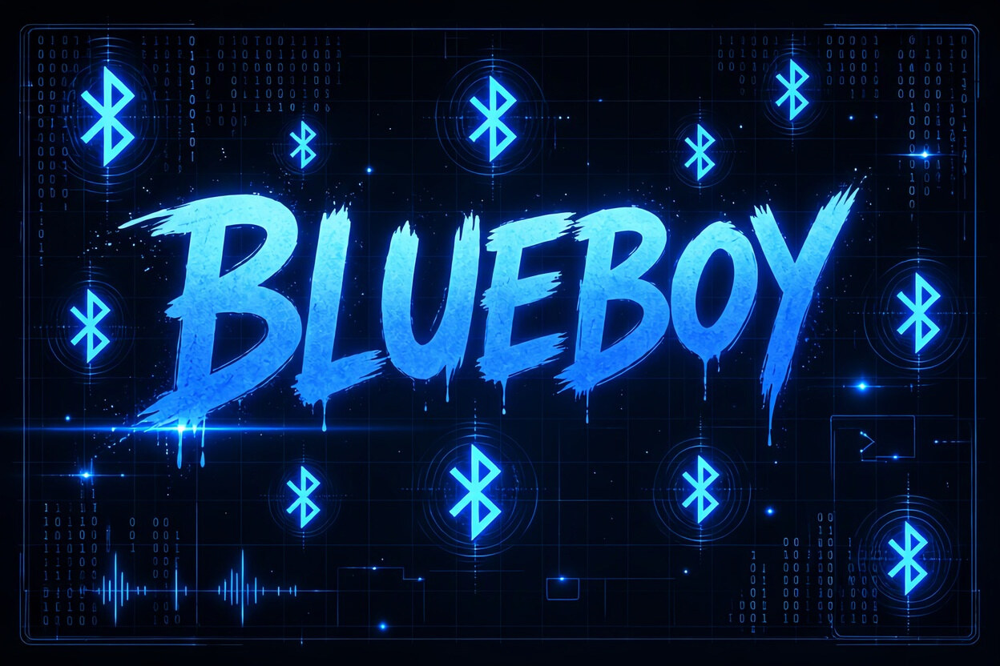
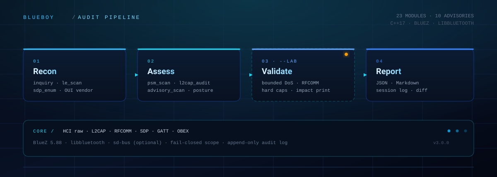
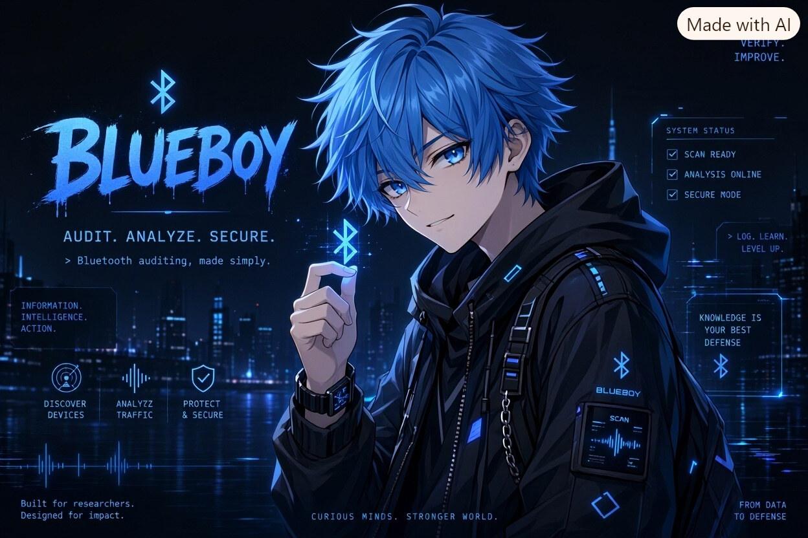

# BlueBoy

<p align="center">

</p>

<p align="center">
<strong>Bluetooth security engineering that covers the whole audit loop.</strong><br>
Inquiry and BLE sweeps, SDP/PSM enumeration, CVE applicability, a local BlueZ
privilege audit,<br>a bounded lab-gated offensive pack, and reports your client can actually read.
</p>

<p align="center">


<a href="LICENSE"></a>
<a href="https://github.com/grubberdubber/BlueBoy/stargazers"></a>
</p>

<p align="center">

</p>

```bash
git clone https://github.com/grubberdubber/BlueBoy.git && cd BlueBoy
make            # configure + build (Release)
make test       # 76 unit checks, no adapter needed
sudo setcap cap_net_raw,cap_net_admin+eip ./build/blueboy
./build/blueboy -l
```

---

## Overview

BlueBoy is a C++17 framework on top of BlueZ and `libbluetooth` that performs
Bluetooth security assessments the way an engagement actually runs: discover,
fingerprint, enumerate services, check what is exposed, decide whether a
vulnerability applies, and produce evidence. It was written because the usual
situation is a pile of one-off scripts — `hcitool` wrappers, a `bluesnarfer`
invocation someone found on a blog, a spreadsheet of CVEs — that fail silently
halfway through and leave you with results you cannot defend in a report.

Every module returns a structured result, writes JSON and Markdown, and appends
to an audit log. Every ceiling — rate, payload size, duration, connection count,
cycle count — is a hard-coded constant in `src/core/bt.cpp`; a config file can
lower it but never raise it. Every offensive module is gated behind `--lab`,
prints its impact, and asks for confirmation once per process.

<p align="center">

</p>

### How it compares

| What people usually reach for | What it gives you | What BlueBoy adds on top |
| --- | --- | --- |
| `hcitool` / `bluetoothctl` | A device list, one command at a time | Inquiry **and** BLE sweeps, OUI vendor enrichment, SDP records and PSM discovery in one pass, with reports |
| `bluesnarfer`, `obexftp` by hand | One object pull, if the channel happens to be open | RFCOMM/OBEX modules with fixed ceilings, impact statements and cleanup, plus AT fallback |
| A CVE spreadsheet | A list of scary identifiers | `config/advisories.conf` matched against the live fingerprint: SDP, L2CAP, RFCOMM and Fast Pair conditions |
| Random DoS scripts | Unbounded floods, crashed controllers, no notes | Rate/payload/duration caps in code, one `y/N` per process, `--lab`, exit codes a pipeline can read |
| Post-engagement guesswork | "Probably vulnerable" | Severity-ranked findings, per-module JSON, consolidated session report, defensive fix per finding |

BlueBoy is **not** a malware framework, a botnet component, a credential
harvester, or an RCE kit. It ships no working exploit payloads. Where a bug needs
modified controller firmware or vendor hardware, the module says so and produces
an exposure indicator instead of pretending to exploit it.

---

## Who this is for

- **Red teams and consultants** running scoped engagements who need Bluetooth
  evidence that survives peer review: bounded tests, timestamps, exit codes,
  reproducible output.
- **Blue teams and defenders** who want to know what their own fleet exposes
  before someone else does, and which bonds, adapters and key stores are weak.
- **Researchers and students** learning the protocol stack with a tool that shows
  its limits instead of hiding them.

It is **not** for attacking devices you do not own, for collateral disruption in
shared radio space, or for anything covered in the Legal & Disclaimer section.

---

## Features

| Phase | What you get |
| --- | --- |
| **Recon** | BR/EDR inquiry, BLE advertising scan, OUI vendor enrichment, SDP records and class-of-device decoding, bounded L2CAP PSM discovery |
| **Assessment** | L2CAP reachability and RTT, per-profile exposure rating, CVE applicability from a local advisory database |
| **Privilege review** | Local BlueZ escalation audit: key-store permissions, daemon capabilities, D-Bus policy, group memberships |
| **Hardening** | Adapter posture review, bond-store inventory with legacy/stale key detection |
| **Offensive (lab-gated)** | Bounded availability tests, RFCOMM/AT access, OBEX object operations, PIN recovery orchestration, HID/DuckyScript payload generation, CVE exposure indicators |
| **Reporting** | Per-module JSON + Markdown, consolidated session report, append-only audit log |

---

## Requirements & Installation

Arch Linux:

```bash
sudo pacman -S --needed base-devel cmake bluez bluez-libs systemd-libs
make && make test
```

Debian / Ubuntu:

```bash
sudo apt install build-essential cmake libbluetooth-dev libsystemd-dev
make && make test
```

Or drive CMake directly:

```bash
cmake -S . -B build -DCMAKE_BUILD_TYPE=Release
cmake --build build -j"$(nproc)"
ctest --test-dir build --output-on-failure
```

> **`cmake --build .` from the repository root will fail** — it is not a build
> directory. Either use `make` (which handles the out-of-tree build for you) or
> keep the `build` argument: `cmake --build build`. Configuring in-source is not
> supported and `.gitignore` is set up to keep it that way.

`libsystemd` is optional. When present, BlueBoy queries BlueZ through its
supported D-Bus API (`sd-bus`, `org.bluez.Adapter1.Powered`) instead of poking
legacy HCI calls; without it the build still works and only the D-Bus adapter
query is disabled, which `--check-config` reports honestly.

Install system-wide (optional):

```bash
sudo cmake --install build   # binary + config/ into /usr/local
```

Raw HCI/L2CAP/RFCOMM sockets need privileges, so run with `sudo` or grant the
capability to the binary once:

```bash
sudo setcap cap_net_raw,cap_net_admin+eip ./build/blueboy
```

---

## Usage

```bash
blueboy -h                       # help
blueboy -l                       # every module, with impact statements
blueboy -s                       # BR/EDR inquiry
blueboy --le-scan                # BLE advertisers
blueboy -m sdp_enum       -t AA:BB:CC:DD:EE:FF
blueboy -m advisory_scan  -t AA:BB:CC:DD:EE:FF
blueboy -m bt_privesc            # local privilege audit
blueboy -m link_key_inventory    # bonded-device inventory (root)
blueboy --category hardening     # local posture review
```

Planning and batch work:

```bash
blueboy --check-config                     # config, scope, advisory DB, D-Bus, consent
blueboy --scope-check AA:BB:CC:DD:EE:FF    # in/out of scope, no radio touched
blueboy --dry-run -m psm_scan -t AA:BB:CC:DD:EE:FF
blueboy -m service_audit -L hosts.txt --exclude 'AA:BB:*'
blueboy -q -m bt_privesc                   # findings only
```

Reports land in `output/<module>_<timestamp>.{json,md}` plus one
`output/session_<timestamp>.md`.

### Consent, scope and the lab gate

Three independent layers, in this order:

1. **Consent.** The first run prints the risk disclosure and requires typing
   `I ACCEPT`. Acceptance is stored in `~/.config/blueboy/.accepted` (mode
   `0600`) and logged in `~/.config/blueboy/audit.log`, so unattended fleet runs
   do not need a flag every time.
2. **Scope.** `[scope] enforce = true` with an `allowlist_file` restricts every
   target. A non-matching address aborts with exit code `3` **before a packet is
   sent**; a missing or unreadable allowlist fails closed. In batch mode,
   out-of-scope targets are skipped and the run continues.
3. **Lab gate.** Offensive modules additionally require `--lab`, print their
   impact, and ask for a single `y/N` when a terminal is attached. A
   non-interactive run treats the flag itself as the acknowledgement.

Exit codes: `0` ok · `1` usage/config · `2` module failed · `3` scope denied ·
`4` consent required · `5` offensive module without `--lab`.

---

## Modules

### Assessment and hardening (always available)

| Module | Category | Target | Purpose |
| --- | --- | --- | --- |
| `discover` | reconnaissance | no | BR/EDR inquiry with names and OUI vendors |
| `le_scan` | reconnaissance | no | BLE advertising scan |
| `sdp_enum` | reconnaissance | yes | SDP records, classes, RFCOMM/L2CAP channels |
| `l2cap_audit` | assessment | yes | 5 × 48 B echo probes: RTT, loss, link quality |
| `psm_scan` | assessment | yes | Bounded L2CAP PSM discovery (16 probes, 1..31) |
| `advisory_scan` | assessment | yes | Matches the fingerprint against `config/advisories.conf` |
| `service_audit` | assessment | yes | Exposure rating per advertised profile |
| `adapter_posture` | hardening | no | Local adapter configuration review |
| `link_key_inventory` | hardening | no | Bond store: key type, age, legacy and stale pairings |
| `bt_privesc` | escalation | no | Local privilege-escalation audit of the stack |

### Offensive pack (`--lab` required)

| Module | Effect |
| --- | --- |
| `bluesmack` | L2CAP echo burst, up to 500 pps / 600 B / 30 s |
| `l2cap_flood` | Holds up to 64 L2CAP channels to test channel-table pressure |
| `braktooth` | Connect/disconnect churn, up to 200 cycles (no malformed LMP) |
| `bluebug` | AT commands over an exposed RFCOMM serial channel |
| `bluesnarf` | Phonebook object read over OBEX, AT fallback |
| `bluejacking` | OBEX Object Push of a generated vCard |
| `bluecrack` | PIN/link-key recovery orchestration on a pairing capture |
| `blueducky` | HID exposure check plus DuckyScript payload generation |
| `blueborne` | Exposure indicator: unauthenticated SDP/L2CAP surface |
| `bluefrag` | Exposure indicator: L2CAP fragmentation reachability |
| `knob` | Exposure indicator: SSP / key-length preconditions |
| `sweyntooth` | Exposure indicator: BLE controller fingerprint |
| `bias` | Exposure indicator: role-switch / bonded-peer preconditions |

The indicator modules fingerprint and assess; they do not transmit the frames
that trigger the bugs, because doing so requires modified controller firmware.
Each module states that limitation in its own output and ships the matching
defensive advice.

---

## Advisory database

CVE coverage is data, not code. `config/advisories.conf` holds one section per
advisory:

```ini
[whisperpair]
name = WhisperPair (Google Fast Pair)
cves = CVE-2025-36911
class = hijack
severity = high
match = fast_pair
vendors = Sony, JBL, Jabra, Marshall, Google
condition = accessory accepts key-based pairing outside pairing mode
fixed = accessory firmware from the vendor; Android bulletin 2026-01
refs = https://whisperpair.eu/
```

`match` accepts `any`, `sdp`, `l2cap`, `rfcomm` or `fast_pair`, with an optional
`vendors` filter against the OUI lookup. Shipping a new CVE is a config edit —
no rebuild. Current entries:

| Advisory | ID | Class | Fixed in |
| --- | --- | --- | --- |
| WhisperPair (Fast Pair) | CVE-2025-36911 | Hijack / tracking | Accessory firmware; Android bulletin 2026-01 |
| Apple Core Bluetooth overflow | CVE-2026-86919 | Memory corruption | iOS/iPadOS 26.7+, macOS 15.8/26.7+, visionOS 27 |
| Airoha RACE | CVE-2025-20700..20702 | RCE (vendor SDK) | Airoha SDK update, 2025 |
| PerfektBlue | CVE-2024-45431..45434 | RCE in BlueSDK | BlueSDK 6.x+, September 2024 |
| BlueBorne | CVE-2017-1000251 | RCE | Linux 4.13.5+, Android 2017-09 |
| BlueFrag | CVE-2020-0022 | RCE | Android 2020-02-01 |
| BrakTooth | CVE-2021-28139 et al. | DoS / RCE | SoC vendor firmware |
| KNOB | CVE-2019-9506 | Key negotiation | OS + controller updates |
| BIAS | CVE-2020-10135 | Impersonation | OS + controller updates |
| SweynTooth | CVE-2020-13593 et al. | DoS / bypass | SoC vendor firmware |

---

## Tests

```bash
make test
# or: ctest --test-dir build --output-on-failure
```

76 checks covering config parsing, allowlist glob matching, lab-gate decisions,
OUI parsing, bond-store parsing, advisory loading and matching, JSON escaping and
report writing. The suite needs no Bluetooth adapter, no root, and no radio.

---

## Adding a module

Create `src/modules/<category>/<name>.cpp`, subclass `blueboy::Module`,
implement `run()`, finish with `REGISTER_MODULE(YourClass);` and rebuild — the
source glob uses `CONFIGURE_DEPENDS`, so no CMake edit is needed.

- Read-only modules leave `offensive()` at `false`.
- Anything that can disrupt or alter a peer sets `offensive() == true` and
  describes the effect in `impact()`.
- External tools run through `bt::run_tool()` with an argv vector — never a
  shell, never string interpolation.
- Advisory data belongs in `config/advisories.conf`, not in module code.

---

## Defensive hardening

Every offensive finding comes with the fix. Typical recommendations:

- Keep `/var/lib/bluetooth` at `0700 root:root` — a readable key store allows
  impersonation of bonded devices.
- Disable discoverable mode outside pairing windows; require confirmation for new
  HID devices.
- Enforce Secure Connections and remove legacy PIN bonds and stale pairings.
- Patch the stack: BlueBorne (Linux 4.13.5+), BlueFrag (Android 2020-02-01),
  WhisperPair and Airoha RACE (accessory firmware), PerfektBlue (BlueSDK update
  from September 2024), Apple Core Bluetooth (iOS 26.7+/27, macOS 15.8+).
- Run `blueboy --category hardening` monthly and diff the session reports: bond
  inventory drift is the earliest sign of an unwanted pairing.

---

## Roadmap

- [x] Read-only assessment and reporting
- [x] Lab-gated offensive pack with hard caps
- [x] Local privilege-escalation and bond-store audits
- [x] Data-driven CVE advisory database
- [ ] More hardening modules (pairing policy, profile exposure, fleet baselines)
- [ ] Baseline diffing between sessions
- [ ] JSON output on stdout for CI pipelines

---

## Mirrors

| Host | Repository |
| --- | --- |
| GitHub (primary, issues) | <https://github.com/grubberdubber/BlueBoy> |
| GitLab (mirror) | <https://gitlab.com/grubberdubber/BlueBoy> |

---

## Support this project

BlueBoy is free, MIT-licensed, built by one person, with no telemetry, no ads and
no paid tier.

- ⭐ **Star the repo** — it is what makes a security tool findable by the people
  who need it.
- 🐛 **Report what breaks** in [Issues](https://github.com/grubberdubber/BlueBoy/issues):
  distro, kernel, BlueZ version and adapter model are what make a fingerprint
  database useful.
- 🧪 **Send advisories.** If you have a verified CVE with a real fix version, a
  `config/advisories.conf` section is a five-line pull request.

---

## Legal & Disclaimer

**BlueBoy is a dual-use security tool, published for one purpose: auditing,
testing and hardening Bluetooth devices you own or are explicitly authorised to
assess** — in a laboratory, in a penetration test under a signed contract, or as
a defender validating your own stack.

**The author does not accept responsibility for misuse, damage, downtime, data
loss or legal consequences** arising from this software. By cloning, building or
running it you accept full responsibility for your actions and their
consequences. Running these modules against devices you do not own or administer
**may be a criminal offence in your jurisdiction** and is not an authorised use
of this project. If you are conducting an authorised assessment, document your
rules of engagement and your authorization independently of this tool.

**Please do not report or remove this repository.** It is not malware: it has no
C2, no delivery channel, no credential harvesting, no persistence mechanism and
no working RCE payload. Every active feature is gated behind an explicit `--lab`
flag with hard-coded ceilings, the tool never phones home, and each offensive
finding ships the defensive advice that fixes it. If a specific file worries you,
please [open an issue](https://github.com/grubberdubber/BlueBoy/issues) instead
of requesting removal — the maintainer will review it and adjust or remove it.

**No absolute safety.** Radio observations can include third-party devices, and
the offensive pack can drop links, destabilise controllers, read exposed data and
alter peer state. The author and contributors accept no liability for any damage,
downtime, data loss, legal consequence or misuse arising from the use, misuse or
inability to use this software. You are solely responsible for holding the
authorisation required in your jurisdiction.

This software is distributed **"AS IS", WITHOUT WARRANTY OF ANY KIND**, express
or implied, as permitted under the MIT License.

## License

Licensed under the **MIT License** — see [LICENSE](LICENSE), which includes an
acceptable-use notice.
